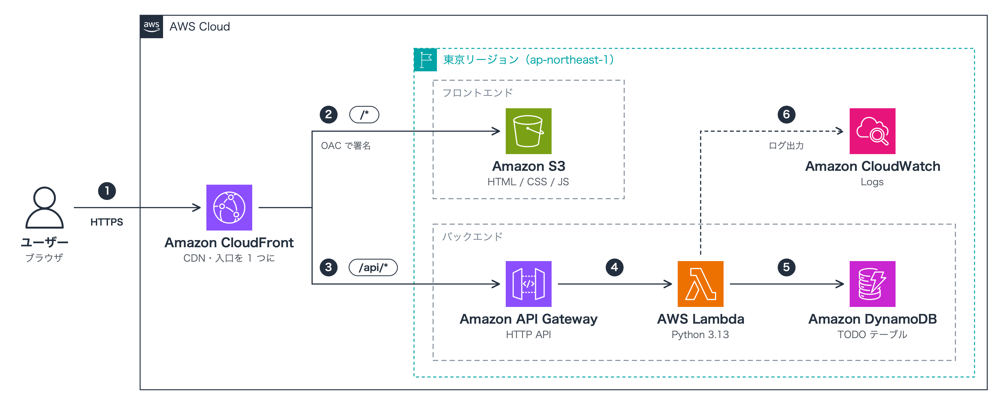

# 【初心者向け・60分】マネジメントコンソールだけで作る！AWS サーバーレス TODO アプリで SAA レベルの知識を身につける

> DynamoDB / Lambda / IAM / API Gateway / S3 / CloudFront を、すべてブラウザの画面操作（GUI）で構築します

---

## はじめに

「AWS の資格勉強はしているけど、実際に手を動かしたことがない」
「サーバーレスってよく聞くけど、何がどうつながっているのかイメージできない」

そんな方に向けて、この記事では **フロントエンドもバックエンドもサーバーレスで動く TODO アプリ** を、**AWS マネジメントコンソール（ブラウザで操作する AWS の管理画面）だけ** を使って、**約 60 分** で構築します。コマンドラインのツールをインストールする必要はありません。

ただ画面をクリックするだけではなく、**AWS 認定ソリューションアーキテクト – アソシエイト（SAA）で問われる知識のうち、今回のアプリに必要な部分** を、そのサービスを触るタイミングで解説します。「なぜこのサービスを選ぶのか」「なぜこの設定にするのか」がわかるようになることがゴールです。

### この記事でできるようになること

- サーバーレスな Web アプリの全体像（どのサービスが何を担当するか）を説明できる
- DynamoDB・Lambda・API Gateway で API を作れる
- S3 + CloudFront で、S3 を **非公開のまま** 静的サイトを公開できる
- IAM の「アイデンティティベースポリシー」と「リソースベースポリシー」の違いを、**わざと権限エラーを起こして** 体感しながら理解できる
- 手作業（コンソール）での構築と、IaC（コードでの構築）の違いを説明できる

### 対象読者

- AWS を触ったことがない〜少し触ったことがある方（コンソールにログインしたことがある程度で OK）
- AWS SAA を勉強中で、知識と実践を結びつけたい方
- プログラミングの経験は問いません（コードはコピー＆ペーストするだけです）

### 所要時間（約 60 分）

[事前準備](#0-事前準備ハンズオンの前に済ませておく) を済ませておけば、**構築から後片付けまで約 60 分** で完了します。各サービスの知識は、そのサービスを触る Step の中で解説します。

| パート | 内容 | 目安 |
| --- | --- | --- |
| [1](#1-完成イメージとアーキテクチャ) | 完成イメージとアーキテクチャ | 5 分 |
| [2](#2-はじめに押さえる-3-つの基礎知識) | はじめに押さえる 3 つの基礎知識 | 5 分 |
| [3](#3-step-1-dynamodb-でテーブルを作る) | Step 1：DynamoDB でテーブルを作る | 5 分 |
| [4](#4-step-2-lambda-で-api-の処理を作る) | Step 2：Lambda で API の処理を作る | 10 分 |
| [5](#5-step-3-iam-で-lambda-に-dynamodb-へのアクセスを許可する) | Step 3：IAM で Lambda に DynamoDB へのアクセスを許可する | 5 分 |
| [6](#6-step-4-api-gateway-で-api-を公開する) | Step 4：API Gateway で API を公開する | 7 分 |
| [7](#7-step-5-s3-にフロントエンドのファイルを置く) | Step 5：S3 にフロントエンドのファイルを置く | 5 分 |
| [8](#8-step-6-cloudfront-で入口を-1-つにまとめる) | Step 6：CloudFront で入口を 1 つにまとめる（デプロイ待ち 約 5 分を含む） | 10 分 |
| [9](#9-step-7-ブラウザで動作確認する) | Step 7：ブラウザで動作確認する | 3 分 |
| [10](#10-後片付け) | 後片付け | 5 分 |
| | **合計** | **60 分** |

時間に余裕がある方向けに、[付録](#付録) に SAA 形式の確認クイズ、SAA 頻出キーワードの早見表、そして **同じ構成を AWS SAM（IaC）でコマンド一発で作る方法** を用意しています。

### 費用

ハンズオンの範囲なら **ほぼ無料（多くても数十円程度）** です。

> [!WARNING]
> 費用は利用状況によって変わります。また、無料利用枠やクレジットの内容はアカウントの作成時期によって異なります。作業前に **AWS Budgets で予算アラートを設定** し（[事前準備](#0-1-aws-アカウントと予算アラート) で説明します）、ハンズオンが終わったら必ず [後片付け](#10-後片付け) をしてください。
>
> また、**CloudFront の定額料金プラン（Pro 以上）や AWS WAF は月額料金がかかります**。[Step 6](#8-step-6-cloudfront-で入口を-1-つにまとめる) では記事のとおりに選択してください。

### 画面の表記について

> [!NOTE]
> AWS のコンソールは頻繁に改善されるため、ボタンの名前や画面の順番が、この記事と少し違うことがあります。その場合は、各 Step にある **「設定する値」の表** を見て、同じ設定になるように進めてください。英語表示のまま、または訳語が異なる場合に備えて、一部の項目には英語表記を（ ）で併記しています。

---

## 目次

0. [事前準備（ハンズオンの前に済ませておく）](#0-事前準備ハンズオンの前に済ませておく)
1. [完成イメージとアーキテクチャ](#1-完成イメージとアーキテクチャ) — 5 分
2. [はじめに押さえる 3 つの基礎知識](#2-はじめに押さえる-3-つの基礎知識) — 5 分
3. [Step 1: DynamoDB でテーブルを作る](#3-step-1-dynamodb-でテーブルを作る) — 5 分
4. [Step 2: Lambda で API の処理を作る](#4-step-2-lambda-で-api-の処理を作る) — 10 分
5. [Step 3: IAM で Lambda に DynamoDB へのアクセスを許可する](#5-step-3-iam-で-lambda-に-dynamodb-へのアクセスを許可する) — 5 分
6. [Step 4: API Gateway で API を公開する](#6-step-4-api-gateway-で-api-を公開する) — 7 分
7. [Step 5: S3 にフロントエンドのファイルを置く](#7-step-5-s3-にフロントエンドのファイルを置く) — 5 分
8. [Step 6: CloudFront で入口を 1 つにまとめる](#8-step-6-cloudfront-で入口を-1-つにまとめる) — 10 分
9. [Step 7: ブラウザで動作確認する](#9-step-7-ブラウザで動作確認する) — 3 分
10. [後片付け](#10-後片付け) — 5 分
11. [まとめ](#11-まとめ)
12. [トラブルシューティング](#12-トラブルシューティング)
13. [付録](#付録)（SAA 確認クイズ / 頻出キーワード早見表 / 変更の反映 / IaC で一発構築 / ローカルテスト / 発展課題）

---

## 0. 事前準備（ハンズオンの前に済ませておく）

⏱ 目安：15〜20 分（**60 分には含みません**。当日までに済ませておいてください）

### 0-1. AWS アカウントと予算アラート

1. AWS アカウントを持っていない場合は、[AWS の公式サイト](https://aws.amazon.com/jp/) から作成します。
2. **ルートユーザー**（アカウント作成時のメールアドレスでログインするユーザー）には必ず **MFA（多要素認証）** を設定しましょう。
3. 想定外の課金に気づけるよう、**予算アラート** を設定しておきます。
   - コンソールで「Billing and Cost Management」→「予算（Budgets）」→「予算を作成」
   - テンプレート「ゼロ支出予算」または「月次コスト予算」を選び、通知先メールアドレスを入力して作成

### 0-2. 作業用のユーザーでコンソールにログインする

ルートユーザーは何でもできてしまうため、日常の作業には使いません。以下のどちらかの方法で、作業用のユーザーでコンソールにログインできるようにしておきます。

<details>
<summary><b>方法 A：IAM Identity Center（SSO）を使う（会社のアカウントなどで推奨）</b></summary>

会社や組織の AWS アカウントでは、IAM Identity Center（旧 AWS SSO）でログインする運用が一般的です。

1. 管理者から **AWS アクセスポータルの URL** を教えてもらい、ブラウザで開いてログインします。
2. 使用するアカウントを展開し、権限セット（ロール）の「マネジメントコンソール」リンクからコンソールを開きます。

</details>

<details>
<summary><b>方法 B：IAM ユーザーを作る（個人アカウントで手軽に試す場合）</b></summary>

1. ルートユーザーでコンソールにログインし、「IAM」→「ユーザー」→「ユーザーの作成」
2. ユーザー名（例：`handson-user`）を入力し、「AWS マネジメントコンソールへのユーザーアクセスを提供する」にチェックを入れて、パスワードを設定します
3. 「許可を設定」で「ポリシーを直接アタッチする」を選び、`AdministratorAccess` にチェックを入れて作成します
4. 表示された **コンソールサインイン URL** から、作成したユーザーでログインし直します。このユーザーにも MFA を設定しておくと安心です

> [!WARNING]
> `AdministratorAccess` はハンズオン用の強い権限です。普段使いのユーザーには、必要な権限だけを付けましょう（最小権限の原則）。

</details>

> [!NOTE]
> このハンズオンでは IAM ロールやポリシーを作成・編集するため、IAM を操作できる権限が必要です。会社のアカウントで権限が足りない場合は、管理者に相談してください。なお、コマンドラインは使わないので、**アクセスキーは不要** です。

### 0-3. ソースコードをダウンロードする

このハンズオンのソースコード一式（リポジトリ）を ZIP でダウンロードして展開します（GitHub の場合は「Code」→「Download ZIP」）。

ハンズオンで使うのは、次の 4 つのファイルだけです。

| ファイル | 中身 | 使う場面 |
| --- | --- | --- |
| `backend/src/lambda_function.py` | TODO API の処理（Python） | [Step 2](#4-step-2-lambda-で-api-の処理を作る) で Lambda に貼り付ける |
| `frontend/index.html` | 画面 | [Step 5](#7-step-5-s3-にフロントエンドのファイルを置く) で S3 にアップロード |
| `frontend/style.css` | 見た目 | 同上 |
| `frontend/app.js` | API を呼び出して画面を描画する | 同上 |

> [!TIP]
> `lambda_function.py` は、VS Code・メモ帳・テキストエディットなどのテキストエディタで開いて中身をコピーします。

### 0-4. リージョンを東京にする

コンソール右上のリージョン表示をクリックし、**アジアパシフィック (東京) ap-northeast-1** を選びます。以降の作業はすべて東京リージョンで行います。

> [!NOTE]
> IAM と CloudFront の画面では、リージョン表示が「グローバル」になります。これらは特定のリージョンに属さない **グローバルサービス** なので、正常です。

**準備完了チェックリスト** ✅

- [ ] 予算アラートを設定した
- [ ] 作業用のユーザーでコンソールにログインできた
- [ ] 右上のリージョンが「アジアパシフィック (東京)」になっている
- [ ] ソースコードの ZIP を展開した

---

## 1. 完成イメージとアーキテクチャ

⏱ 目安：5 分

### 1-1. 作るもの

シンプルな TODO アプリです。TODO の **追加・一覧表示・完了チェック・削除** ができます。

```text
  Serverless TODO
  S3 + CloudFront + API Gateway + Lambda + DynamoDB

  [ やることを入力...                    ] [ 追加 ]

  ☑ ハンズオンの準備をする                  削除
  ☐ コンソールで構築する                    削除
  ☐ SAA の問題集を解く                      削除

                              残り 2 件 / 全 3 件
```

### 1-2. アーキテクチャ図



<sub>※ アイコンは [AWS Architecture Icons](https://aws.amazon.com/jp/architecture/icons/) を使用しています。</sub>

図中の番号は、リクエストが流れる順番です。

| # | 何が起きるか | 関係する設定・権限 |
| --- | --- | --- |
| 1 | ブラウザから CloudFront に HTTPS でアクセスする | HTTP は HTTPS にリダイレクト |
| 2 | `/api/*` 以外のパスは、S3 から HTML / CSS / JS を取得する | **OAC** で署名し、S3 の **バケットポリシー** で許可。S3 は非公開のまま |
| 3 | `/api/*` のパスは、API Gateway へ転送する | キャッシュしない |
| 4 | API Gateway が Lambda を呼び出す | Lambda の **リソースベースポリシー** で許可 |
| 5 | Lambda が DynamoDB を読み書きする | Lambda の **実行ロール**（IAM）で許可 |
| 6 | Lambda のログを CloudWatch Logs に出力する | Lambda の **実行ロール**（IAM）で許可 |

ポイントは **入口が CloudFront ひとつだけ** であることです。CloudFront が URL のパスを見て振り分けます。

- `https://xxxx.cloudfront.net/` → S3 に置いた HTML / CSS / JS を返す（フロントエンド）
- `https://xxxx.cloudfront.net/api/todos` → API Gateway → Lambda → DynamoDB（バックエンド）

> [!TIP]
> 表の「関係する設定・権限」に出てくる OAC・バケットポリシー・リソースベースポリシー・実行ロールは、この記事でいちばん大事なポイントです。今はわからなくても大丈夫。[2-3 の IAM](#2-3-iam--誰が何に何をできるか) と各 Step で、もう一度この図に戻ってきます。

### 1-3. 作る順番

図の **右（データ）から左（入口）へ** 向かって作り、1 つ作るたびに動作を確認しながら進めます。

| Step | 作るもの | 図の番号 | 確認方法 |
| --- | --- | --- | --- |
| 1 | DynamoDB のテーブル | — | テーブルが「アクティブ」になる |
| 2 | Lambda 関数 | — | Lambda のテスト機能で実行（**わざと失敗する**） |
| 3 | IAM の権限 | 5・6 | もう一度テストして成功する |
| 4 | API Gateway | 4 | ブラウザで API の URL を開く |
| 5 | S3 バケット | — | ファイルがアップロードされている |
| 6 | CloudFront | 1・2・3 | — |
| 7 | — | すべて | ブラウザでアプリを操作する |

### 1-4. 従来型の構成と比べてみる

SAA では、EC2 を使った「3 層アーキテクチャ」もよく出題されます。今回の構成と対応づけておきましょう。

| 役割 | 従来型（サーバーあり） | 今回（サーバーレス） |
| --- | --- | --- |
| 静的ファイルの配信 | EC2 上の Nginx など | **S3 + CloudFront** |
| 入口・ルーティング | ALB（Application Load Balancer） | **API Gateway** |
| アプリケーションの実行 | EC2 + Auto Scaling グループ | **Lambda** |
| データベース | RDS（Multi-AZ） | **DynamoDB** |
| 料金 | 起動している時間に課金（アクセスがなくても） | **使った分だけ課金** |

サーバーレスの最大のメリットは、**サーバーの管理から解放され、使った分だけ支払えばよい** ことです。

---

## 2. はじめに押さえる 3 つの基礎知識

⏱ 目安：5 分

ここでは、すべてのサービスに共通する 3 つの知識だけを押さえます。各サービスの知識は、そのサービスを触る Step の中で解説します。**🎯** は試験対策のポイントです。

### 2-1. サーバーレスと責任共有モデル

**サーバーレス** とは「サーバーが存在しない」ではなく、**「サーバーの存在を意識しなくてよい」** という意味です。OS のパッチ適用、台数の増減、故障時の入れ替えなどはすべて AWS が担当します。

AWS の **責任共有モデル** では、「AWS が責任を持つ範囲」と「利用者が責任を持つ範囲」が分かれています。

| | EC2 | Lambda（サーバーレス） |
| --- | --- | --- |
| OS・ランタイムのパッチ適用 | **利用者** | AWS |
| スケーリング（台数の増減） | **利用者**（Auto Scaling を設定） | AWS（自動） |
| コード・IAM の権限設定・データ | 利用者 | **利用者** |

サーバーレスでも、**コードと権限設定とデータは利用者の責任** です。今回のハンズオンでも、権限の設定（Step 3）は私たちが行います。

> 🎯 「運用負荷を最小限にしたい」「サーバーを管理したくない」→ Lambda / Fargate / DynamoDB などのマネージド・サーバーレスサービスを選ぶ

### 2-2. リージョン・アベイラビリティーゾーン・エッジロケーション

| 用語 | 説明 | 今回の例 |
| --- | --- | --- |
| **リージョン** | 世界中にある AWS の拠点（地域） | 東京リージョン（`ap-northeast-1`） |
| **アベイラビリティーゾーン（AZ）** | リージョン内にある、物理的に離れたデータセンター群。1 リージョンに 3 つ以上 | Lambda・DynamoDB・S3 は **自動的に複数 AZ にまたがって** 動く |
| **エッジロケーション** | CloudFront がコンテンツをキャッシュする、世界中の拠点 | ユーザーに近いエッジから HTML や JS が返る |

EC2 や RDS では Multi-AZ 構成を自分で設計しますが、今回使うサービスは **何もしなくても複数 AZ で冗長化** されています。また、CloudFront と IAM は特定のリージョンに属さない **グローバルサービス** です（アーキテクチャ図でも CloudFront は東京リージョンの外に置いています）。

> 🎯 高可用性 = 複数 AZ に分散すること。S3（1 ゾーン-IA 以外）・DynamoDB・Lambda は標準で複数 AZ に冗長化される

### 2-3. IAM — 「誰が」「何に」「何をできるか」

**IAM（Identity and Access Management）** は、AWS の権限管理の仕組みです。

| 用語 | 説明 |
| --- | --- |
| **IAM ユーザー** | 人（やアプリ）に発行する ID。長期的な認証情報（パスワード・アクセスキー）を持つ |
| **IAM ロール** | 一時的に「なりすます」ための ID。**AWS のサービス（Lambda など）に権限を渡すときはロールを使う** |
| **IAM ポリシー** | 「どの操作（Action）を、どのリソース（Resource）に、許可/拒否（Effect）するか」を JSON で書いたもの |

#### 2 種類のポリシー（今回の最重要ポイント）

| 種類 | どこに付けるか | 書き方のイメージ |
| --- | --- | --- |
| **アイデンティティベースポリシー** | ユーザー・グループ・**ロール** に付ける | 「**私は** ○○ を操作してよい」 |
| **リソースベースポリシー** | **S3 バケットや Lambda 関数などのリソース側** に付ける | 「**○○ さんは私を** 操作してよい」 |

今回のアプリでは、[アーキテクチャ図](#1-2-アーキテクチャ図) の 3 つの矢印で「サービス間のアクセス」が発生し、それぞれ違う方法で許可します。**誰が設定するか** にも注目してください。

| 図の番号 | 誰が | 何に | どうやって許可するか | 種類 | 誰が設定するか |
| --- | --- | --- | --- | --- | --- |
| 5 | Lambda | DynamoDB | Lambda の **実行ロール** に DynamoDB 操作を許可するポリシーを付ける | アイデンティティベース | **自分で**（[Step 3](#5-step-3-iam-で-lambda-に-dynamodb-へのアクセスを許可する)） |
| 4 | API Gateway | Lambda | Lambda 関数に「API Gateway からの呼び出しを許可」するポリシーを付ける | リソースベース | コンソールが自動で（[Step 4](#6-step-4-api-gateway-で-api-を公開する)） |
| 2 | CloudFront | S3 | S3 の **バケットポリシー** に「この CloudFront からの読み取りを許可」と書く | リソースベース | コンソールが自動で（[Step 6](#8-step-6-cloudfront-で入口を-1-つにまとめる)） |

> 🎯 **SAA ではここが問われる**
> - **最小権限の原則**：必要な操作だけを、必要なリソースにだけ許可する
> - EC2 や Lambda から AWS サービスを使うときは、**アクセスキーを埋め込まず、IAM ロールを使う**
> - 別アカウントやサービスからのアクセスを許可したい → リソースベースポリシー（S3 バケットポリシーなど）

---

## 3. Step 1: DynamoDB でテーブルを作る

⏱ 目安：5 分

まずは TODO を保存するデータベースを作ります。

### 3-1. テーブルを作成する

1. コンソール上部の検索バーに「DynamoDB」と入力して開きます。
2. 左メニューの「テーブル」→「テーブルの作成」をクリックします。
3. 次のように設定します。

   | 項目 | 設定する値 |
   | --- | --- |
   | テーブル名 | `serverless-todo` |
   | パーティションキー | `id`（タイプ：**文字列**） |
   | ソートキー | 空欄のまま |
   | テーブル設定 | 「デフォルト設定」のままで、キャパシティモードが **オンデマンド** と表示されていることを確認（違う場合は「設定をカスタマイズ」を選び、キャパシティモードを「オンデマンド」にする） |

4. 「テーブルの作成」をクリックします。数十秒でステータスが **「アクティブ」** になれば完了です。
5. テーブル名をクリックし、「概要」タブの「一般的な情報」にある「追加情報」を展開して、**Amazon リソースネーム (ARN)** をコピーし、メモ帳などに貼っておきます。[Step 3](#5-step-3-iam-で-lambda-に-dynamodb-へのアクセスを許可する) で使います。

   ```text
   arn:aws:dynamodb:ap-northeast-1:123456789012:table/serverless-todo
   ```

> [!NOTE]
> **ARN（Amazon Resource Name）** は、AWS のリソースを世界で一意に特定する名前です。`arn:aws:サービス:リージョン:アカウントID:リソース` の形をしています。IAM ポリシーで「どのリソースに」を指定するときに使います。

### 3-2. 知識：Amazon DynamoDB — フルマネージド NoSQL データベース

**DynamoDB** は、キーバリュー型の NoSQL データベースです。サーバー管理は不要で、データが増えても **一桁ミリ秒の応答速度** を維持できます。

作成画面で **パーティションキー**（アイテムを一意に識別するキー）しか聞かれなかったことに気づいたでしょうか。DynamoDB はキー以外の属性を事前に定義する必要がない **スキーマレス** なデータベースです。今回のアプリは、次の属性を持つアイテムを保存します。

| 属性名 | 型 | 説明 |
| --- | --- | --- |
| `id` | 文字列 | **パーティションキー**。UUID |
| `title` | 文字列 | TODO の内容 |
| `done` | 真偽値 | 完了したかどうか |
| `createdAt` / `updatedAt` | 文字列 | 作成日時 / 更新日時 |

| キャパシティモード | 課金 | 向いている用途 |
| --- | --- | --- |
| **オンデマンド ← 今回** | リクエスト数に応じた従量課金 | アクセス数が予測できない・変動が大きい |
| プロビジョンド | 事前に設定した読み書きの容量に課金 | アクセス数が安定していて予測できる |

データの読み方には、キーを指定して必要な分だけ読む **Query** と、テーブル全体を読む **Scan** があります。今回は小さなアプリなので Scan で全件取得していますが、本番では Query で読めるようにテーブルを設計するのが基本です。

> 🎯 アクセス数が予測できない → **オンデマンド**。Scan は遅く高い → **Query** で読めるキー設計にする（必要なら **GSI** を追加）

---

## 4. Step 2: Lambda で API の処理を作る

⏱ 目安：10 分

次に、TODO の追加・一覧・更新・削除を行うプログラムを Lambda で動かします。

### 4-1. 関数を作成する

1. 検索バーから「Lambda」を開き、「関数の作成」をクリックします。
2. 「一から作成」を選び、次のように設定します。

   | 項目 | 設定する値 |
   | --- | --- |
   | 関数名 | `serverless-todo-api` |
   | ランタイム | **Python 3.13** |
   | アーキテクチャ | **arm64** |
   | 実行ロール（「デフォルトの実行ロールの変更」を開く） | **「基本的な Lambda アクセス権限で新しいロールを作成」**（デフォルトのまま） |

3. 「関数の作成」をクリックします。

> [!NOTE]
> ランタイムの一覧に Python 3.13 がない場合は、より新しい Python 3 系のバージョンを選んでも動きます。アーキテクチャの **arm64** は AWS 独自の CPU（Graviton）で、x86_64 より料金が安く設定されています。

### 4-2. コードを貼り付けてデプロイする

1. 「コード」タブのエディタに、`lambda_function.py` というファイルが開いています。中身を **すべて削除** します。
2. [事前準備](#0-3-ソースコードをダウンロードする) でダウンロードした `backend/src/lambda_function.py` の中身を **すべてコピー** して、貼り付けます。
3. エディタの左側にある **「Deploy」** をクリックします。「Successfully updated the function serverless-todo-api.」のように表示されれば成功です。

> [!IMPORTANT]
> コードを編集しても、**「Deploy」を押すまで Lambda には反映されません**。テストがうまくいかないときは、まず Deploy を押し忘れていないか確認しましょう。

### 4-3. 環境変数とタイムアウトを設定する

「設定」タブで、次の 2 か所を変更します。

| 場所 | 操作 | 設定する値 |
| --- | --- | --- |
| 「環境変数」 | 「編集」→「環境変数の追加」→「保存」 | キー：`TABLE_NAME`、値：`serverless-todo` |
| 「一般設定」 | 「編集」→「保存」 | メモリ：`256` MB、タイムアウト：`0` 分 `10` 秒 |

コードの中にテーブル名を直接書かず、**環境変数** から読み込むようにしています。こうしておくと、開発用・本番用でテーブルを切り替えるときにコードを変更せずに済みます。タイムアウトのデフォルトは 3 秒なので、余裕を持たせて 10 秒にしています。

### 4-4. テストする（ここでわざと失敗します）

API Gateway をつなぐ前に、Lambda 単体で動くか確かめます。

1. 「テスト」タブを開き、「新しいイベントを作成」を選びます。
2. イベント名に `list-todos` と入力し、イベント JSON を次の内容に書き換えて「保存」します。

   ```json
   {
     "routeKey": "GET /api/todos"
   }
   ```

3. 「テスト」をクリックします。

次のような **エラー** になります 🙅

```text
"errorMessage": "An error occurred (AccessDeniedException) when calling the Scan operation:
  User: arn:aws:sts::123456789012:assumed-role/serverless-todo-api-role-abcd1234/serverless-todo-api
  is not authorized to perform: dynamodb:Scan
  on resource: arn:aws:dynamodb:ap-northeast-1:123456789012:table/serverless-todo
  because no identity-based policy allows the dynamodb:Scan action",
"errorType": "ClientError",
```

（読みやすいように改行しています）

これは **想定どおりの失敗** です。エラーメッセージを読み解いてみましょう。

| メッセージ | 意味 |
| --- | --- |
| `assumed-role/serverless-todo-api-role-abcd1234` | Lambda は、作成時に自動で作られた **実行ロール** になりすまして（Assume して）動いている |
| `is not authorized to perform: dynamodb:Scan` | そのロールには DynamoDB の Scan を行う権限がない |
| `no identity-based policy allows ...` | **アイデンティティベースポリシー** で許可されていない |

つまり、**コードは正しく動いていて、DynamoDB にもたどり着いた。でも権限がなくて断られた** という状態です。AWS では、**明示的に許可されていない操作はすべて拒否** されます。次の Step 3 で権限を与えましょう。

### 4-5. 知識：AWS Lambda — サーバーレスなコード実行環境

**Lambda** は、コードをアップロードしておくだけで、**イベント（HTTP リクエストなど）が発生したときに実行してくれる** サービスです。

| 項目 | 内容 |
| --- | --- |
| 最大実行時間 | **15 分** |
| メモリ | 128 MB〜10,240 MB（**CPU 性能はメモリに比例**） |
| 料金 | リクエスト数 + 実行時間 × メモリ量。待機中は課金されない |
| 権限 | **実行ロール**（IAM ロール）で与える |
| ログ | `print()` の出力やエラーは **CloudWatch Logs** に自動で保存される |

Lambda は最初の呼び出し時に実行環境を準備するため、数百ミリ秒ほど遅くなります（**コールドスタート**）。一度準備された環境はしばらく再利用されるので、2 回目以降は速くなります（**ウォームスタート**）。

#### 貼り付けたコードのポイント

**ポイント 1：初期化はハンドラーの外で、テーブル名は環境変数から**

```python
TABLE_NAME = os.environ["TABLE_NAME"]
table = boto3.resource("dynamodb").Table(TABLE_NAME)
```

`boto3` は AWS を Python から操作する公式ライブラリで、Lambda の Python ランタイムに最初から入っています。この 2 行はハンドラー関数の **外** にあるので、コールドスタートのときに 1 回だけ実行され、ウォームスタートでは再利用されます。

また、コードの中に **アクセスキーが一切出てこない** ことに注目してください。Lambda は **実行ロール** の一時的な認証情報を自動で使います。

**ポイント 2：`routeKey` で処理を振り分ける**

```python
def lambda_handler(event, context):
    route_key = event.get("routeKey", "")
    ...
        if route_key == "GET /api/todos":
            return list_todos()
        if route_key == "POST /api/todos":
            return create_todo(parse_body(event))
```

Lambda は `lambda_function.py` の `lambda_handler` 関数を呼び出します（「コード」タブの下にある「ランタイム設定」の **ハンドラー** が `lambda_function.lambda_handler` になっています）。API Gateway からは `"routeKey": "GET /api/todos"` のような情報を含む **イベント** が渡されるので、さきほどのテストではそれを手書きして渡しました。戻り値は `statusCode`・`headers`・`body` を持つ辞書で、API Gateway がこれを HTTP レスポンスに変換します。

**ポイント 3：存在しない ID の更新を防ぐ**

```python
table.update_item(
    ...
    ConditionExpression="attribute_exists(id)",
)
```

DynamoDB の `update_item` は、**指定したキーのアイテムが存在しないと新しく作ってしまいます**。条件を付けることで、存在しない ID なら `404` を返すようにしています。

> 🎯 **SAA ではここが問われる**
> - **15 分を超える処理は Lambda では実行できない** → ECS（Fargate）や Step Functions を使う
> - コールドスタートを避けたい → **プロビジョニングされた同時実行**
> - パスワードなどの機密情報は環境変数に平文で置かず、**Secrets Manager** や Parameter Store を使う

---

## 5. Step 3: IAM で Lambda に DynamoDB へのアクセスを許可する

⏱ 目安：5 分

Lambda の **実行ロール** に、DynamoDB を操作する権限を追加します（[アーキテクチャ図](#1-2-アーキテクチャ図) の矢印 **5**）。

### 5-1. 実行ロールにポリシーを追加する

1. Lambda の「設定」タブ →「アクセス権限」を開き、**実行ロール** のロール名（`serverless-todo-api-role-xxxxxxxx`）をクリックします。IAM の画面が開きます。
2. 「許可」タブの「許可ポリシー」に、`AWSLambdaBasicExecutionRole-...` というポリシーが 1 つだけ付いていることを確認します（これが何かは [5-3](#5-3-知識iam-ポリシーの評価と最小権限) で説明します）。
3. 「許可を追加」→「インラインポリシーを作成」をクリックします。
4. ポリシーエディタで「JSON」を選び、中身を次の内容に置き換えます。`Resource` の値は、[Step 1](#3-1-テーブルを作成する) でコピーした **テーブルの ARN** に書き換えてください。

   ```json
   {
     "Version": "2012-10-17",
     "Statement": [
       {
         "Effect": "Allow",
         "Action": [
           "dynamodb:Scan",
           "dynamodb:PutItem",
           "dynamodb:UpdateItem",
           "dynamodb:DeleteItem"
         ],
         "Resource": "arn:aws:dynamodb:ap-northeast-1:123456789012:table/serverless-todo"
       }
     ]
   }
   ```

5. 「次へ」をクリックし、ポリシー名に `serverless-todo-dynamodb` と入力して「ポリシーの作成」をクリックします。

> [!TIP]
> テーブルの ARN をメモし忘れた場合は、Step 2 のテストのエラーメッセージ（`on resource: arn:aws:dynamodb:...`）からもコピーできます。

このポリシーは、「**`serverless-todo` テーブルに対して**、**アプリが使う 4 つの操作だけ** を許可する」という意味です。Lambda のコードが使っている DynamoDB の操作は、一覧（Scan）・作成（PutItem）・更新（UpdateItem）・削除（DeleteItem）の 4 つだけなので、それ以外は許可しません。

### 5-2. もう一度テストする

1. Lambda の画面に戻り、「テスト」タブで `list-todos` を選んで「テスト」をクリックします。今度は **成功** し、次のような結果が返ります（TODO がまだないので `items` は空です）。

   ```json
   {
     "statusCode": 200,
     "headers": {
       "Content-Type": "application/json; charset=utf-8"
     },
     "body": "{\"items\": []}"
   }
   ```

   > [!NOTE]
   > IAM の変更が反映されるまで、数秒かかることがあります。まだ `AccessDeniedException` になる場合は、少し待ってから再実行してください。

2. 「新しいイベントを作成」で、イベント名 `create-todo` のイベントを次の内容で作り、「テスト」をクリックします。

   ```json
   {
     "routeKey": "POST /api/todos",
     "body": "{\"title\": \"Lambda のテストから追加\"}"
   }
   ```

   `"statusCode": 201` と、作成された TODO（`id` や `createdAt` 付き）が返れば成功です 🎉

3. もう一度 `list-todos` でテストすると、追加した TODO が一覧に含まれています。

> [!TIP]
> 実行結果の「ログ」の最後にある `REPORT` 行に **`Init Duration`** が表示されていれば、それが **コールドスタート** の初期化時間です。続けてテストすると表示されなくなる（ウォームスタート）ことも確かめてみてください。

### 5-3. 知識：IAM ポリシーの評価と最小権限

#### なぜ最初は失敗したのか

IAM は、リクエストのたびに次の順番で「許可するかどうか」を判断します。

```text
明示的な Deny（拒否）がある？ ── はい ──▶ 拒否
        │ いいえ
        ▼
Allow（許可）がある？ ────────── はい ──▶ 許可
        │ いいえ
        ▼
拒否（暗黙的な拒否） ◀── Step 2 のテストはここで止まっていた
```

何も書かれていなければ拒否される（**暗黙的な拒否**）ので、必要な権限は **明示的に Allow する** 必要があります。

#### 実行ロールに付いている 2 つのポリシー

実行ロールの「許可」タブを見ると、ポリシーが 2 つになっています。

| ポリシー | 誰が付けたか | 許可している内容 | 図の番号 |
| --- | --- | --- | --- |
| `AWSLambdaBasicExecutionRole-...` | Lambda の作成時に **自動で** | CloudWatch Logs へのログの書き込み | 6 |
| `serverless-todo-dynamodb` | **自分で**（Step 3） | `serverless-todo` テーブルへの 4 つの操作 | 5 |

Step 2 のテストでエラーのログが見られたのは、最初からログを書き込む権限だけは付いていたからです。

#### ロールの「信頼関係」

ロールの「信頼関係」タブを開くと、次のような **信頼ポリシー** が設定されています。

```json
{
  "Effect": "Allow",
  "Principal": { "Service": "lambda.amazonaws.com" },
  "Action": "sts:AssumeRole"
}
```

「Lambda というサービスが、このロールになりすましてよい」という意味です。**許可ポリシー（何ができるか）** と **信頼ポリシー（誰がこのロールを使えるか）** の 2 つがそろって、はじめて Lambda がこのロールの権限で動けます。

#### 最小権限の原則

AWS が用意している `AmazonDynamoDBFullAccess` というポリシーを付けても、アプリは動きます。しかしこれは **すべてのテーブルに対して、テーブルの削除まで含むすべての操作** を許可してしまいます。万が一コードに脆弱性があったときの被害を小さくするため、**必要な操作だけを、必要なリソースにだけ** 許可するのが鉄則です。

| ポリシーの種類 | 説明 |
| --- | --- |
| **AWS 管理ポリシー** | AWS が用意している汎用的なポリシー（`AmazonDynamoDBFullAccess` など）。手軽だが権限が広くなりがち |
| **カスタマー管理ポリシー** | 自分で作り、複数のユーザーやロールで使い回せるポリシー |
| **インラインポリシー ← 今回** | 特定の 1 つのロールなどに直接埋め込むポリシー。ロールを削除すると一緒に消える |

> 🎯 **SAA ではここが問われる**
> - ポリシーの評価順は **明示的な Deny ＞ Allow ＞ 暗黙的な拒否**
> - AWS のサービスに権限を与える → **IAM ロール**（信頼ポリシーでサービスを指定し、許可ポリシーで操作を指定）
> - **最小権限の原則**：AWS 管理ポリシーより、操作とリソースを絞ったポリシーを使う

---

## 6. Step 4: API Gateway で API を公開する

⏱ 目安：7 分

Lambda をインターネットから呼び出せるように、API の入口を作ります（[アーキテクチャ図](#1-2-アーキテクチャ図) の矢印 **4**）。

### 6-1. HTTP API を作成する

1. 検索バーから「API Gateway」を開き、「API を作成」をクリックします。
2. **「HTTP API」** の「構築」をクリックします（REST API ではないので注意）。
3. 「API を作成」の画面で、次のように設定して「次へ」をクリックします。

   | 項目 | 設定する値 |
   | --- | --- |
   | 統合 | 「統合を追加」→「Lambda」を選び、リージョン `ap-northeast-1`、Lambda 関数 `serverless-todo-api`、バージョン `2.0` |
   | API 名 | `serverless-todo-api` |
   | IP アドレスのタイプ | IPv4 |

4. 「ルートを設定」の画面で、次の **4 つのルート** を設定して「次へ」をクリックします。最初から 1 行（メソッド `ANY` など）入っているので、それを書き換え、「ルートを追加」で残りを追加します。統合ターゲットはすべて `serverless-todo-api` です。

   | メソッド | リソースパス | 処理 |
   | --- | --- | --- |
   | `GET` | `/api/todos` | 一覧を取得 |
   | `POST` | `/api/todos` | 作成 |
   | `PUT` | `/api/todos/{id}` | 更新 |
   | `DELETE` | `/api/todos/{id}` | 削除 |

   `{id}` は **パスパラメータ** です。`/api/todos/abc123` のようなリクエストが来ると、`abc123` の部分が Lambda に `id` として渡されます。

5. 「ステージを定義」の画面は、ステージ名 `$default`・**自動デプロイがオン** のまま「次へ」をクリックします。
6. 確認画面で「作成」をクリックします。

### 6-2. ブラウザで API を呼んでみる

作成した API の詳細画面に表示される **「URL を呼び出す」（Invoke URL）** をコピーします。

```text
https://abcd1234.execute-api.ap-northeast-1.amazonaws.com
```

この URL の後ろに `/api/todos` を付けて、ブラウザの新しいタブで開きます。

```text
https://abcd1234.execute-api.ap-northeast-1.amazonaws.com/api/todos
```

Step 3 で追加した TODO が JSON で表示されれば成功です 🎉（図の矢印 4 → 5）

```json
{"items": [{"id": "3f2a9c1e-...", "title": "Lambda のテストから追加", "done": false, ...}]}
```

### 6-3. Lambda に追加された「呼び出し許可」を確認する

Step 3 では IAM を自分で設定しましたが、API Gateway から Lambda を呼び出す権限は設定していません。なぜ動いたのでしょうか？

Lambda の画面に戻り、「設定」タブ →「アクセス権限」を下にスクロールして、**「リソースベースのポリシーステートメント」** を見てみましょう。API Gateway の画面で統合を作ったときに、**コンソールが自動で追加した** ステートメントがあります。

| 項目 | 値 | 意味 |
| --- | --- | --- |
| プリンシパル | `apigateway.amazonaws.com` | API Gateway **が** |
| アクション | `lambda:InvokeFunction` | この関数 **を呼び出してよい** |
| 条件 | `AWS:SourceArn` が `arn:aws:execute-api:ap-northeast-1:...:abcd1234/*/*/api/todos` など | ただし **この API からの呼び出しに限る** |

これが **リソースベースポリシー**（図の矢印 **4**）です。Step 3 の実行ロールと比べてみましょう。

| | Step 3：実行ロールのポリシー | Step 4：Lambda のリソースベースポリシー |
| --- | --- | --- |
| 種類 | アイデンティティベース | リソースベース |
| 付けた場所 | ロール（Lambda が使う ID） | Lambda 関数そのもの |
| 意味 | Lambda **が** DynamoDB **を** 操作してよい | API Gateway **が** Lambda **を** 呼び出してよい |

### 6-4.（任意）スロットリングを設定する

時間に余裕があれば、想定外の大量アクセスで料金が膨らまないように流量制限を設定しておきましょう。

1. API の左メニュー「保護」→「スロットリング」を開きます。
2. ステージ `$default` のデフォルトのスロットリング設定を「編集」し、**バースト制限 `20`・レート制限 `10`** を設定して保存します。

上限を超えるリクエストには、`429 Too Many Requests` が返るようになります。

### 6-5. 知識：Amazon API Gateway — API の入口

**API Gateway** は、HTTP リクエストを受け付けて Lambda などに渡す「API の玄関口」です。

| 種類 | 特徴 |
| --- | --- |
| **HTTP API ← 今回** | 低コスト・低レイテンシ・シンプル |
| **REST API** | 高機能（API キー・使用量プラン・キャッシュ・リクエスト検証・WAF 連携など） |
| **WebSocket API** | 双方向のリアルタイム通信（チャットなど） |

**ステージ** は API の公開環境（`dev`・`prod` など）のことです。今回は特別なステージ `$default` を使っているので、URL にステージ名が入りません。また、自動デプロイをオンにしているので、ルートを変更するとすぐに反映されます。

> 🎯 API キー・使用量プラン・キャッシュが必要なら **REST API**、シンプルに安く作るなら **HTTP API**。急激なアクセス増からバックエンドを守る → **スロットリング**

---

## 7. Step 5: S3 にフロントエンドのファイルを置く

⏱ 目安：5 分

ここからはフロントエンドです。まずは HTML / CSS / JS を置く場所を作ります。

### 7-1. バケットを作成する

1. 検索バーから「S3」を開き、「バケットを作成」をクリックします。
2. 次のように設定して、「バケットを作成」をクリックします。

   | 項目 | 設定する値 |
   | --- | --- |
   | バケットタイプ | 汎用 |
   | バケット名 | `serverless-todo-frontend-<任意の文字列>`（例：`serverless-todo-frontend-taro-20261022`） |
   | このバケットのブロックパブリックアクセス設定 | **「パブリックアクセスをすべてブロック」にチェックが入ったまま** |
   | その他 | すべてデフォルトのまま |

> [!NOTE]
> バケット名は **世界中のすべての AWS アカウントで一意** である必要があります。小文字・数字・ハイフンが使えます。「すでに存在します」と表示されたら、末尾の文字列を変えてください。

### 7-2. ファイルをアップロードする

1. 作成したバケット名をクリックし、「アップロード」をクリックします。
2. 「ファイルを追加」で、ダウンロードした `frontend/` フォルダの中にある **`index.html`・`style.css`・`app.js` の 3 つ** を選びます。
3. 「アップロード」をクリックします。

> [!IMPORTANT]
> `frontend` フォルダごとアップロードしないでください。バケットの **一番上の階層** に 3 つのファイルが並んでいる状態にします（フォルダごとアップロードすると、URL が `/frontend/index.html` になってしまいます）。

この時点では、バケットは非公開なので、まだ誰もこのファイルを見ることはできません。次の Step で CloudFront から見えるようにします。

### 7-3. 知識：Amazon S3 — ファイルを保存するストレージ

**S3（Simple Storage Service）** は、ファイル（**オブジェクト**）を **バケット** という入れ物に保存するストレージです。**99.999999999%（イレブンナイン）の耐久性** を持ち、データは自動的に複数の AZ に保存されます。新しく作るバケットは、**ブロックパブリックアクセスがオン**・**暗号化（SSE-S3）が有効** な状態がデフォルトです。

S3 には「静的ウェブサイトホスティング」という機能もありますが、今回はあえて使いません。

| | S3 静的ウェブサイトホスティング | **S3 + CloudFront（OAC）← 今回** |
| --- | --- | --- |
| バケットの公開設定 | パブリックにする必要がある | **非公開のまま** |
| HTTPS | 非対応（HTTP のみ） | **対応** |
| 配信速度 | リージョンから直接配信 | エッジからキャッシュ配信で速い |

> 🎯 **SAA ではここが問われる**
> - 意図しない公開を防ぐ → **ブロックパブリックアクセス**（アカウント単位・バケット単位で設定できる）
> - アクセス頻度が低いデータを安く保存 → **標準-IA**、さらに低頻度なら **Glacier** 系。アクセスパターンが読めない → **Intelligent-Tiering**

---

## 8. Step 6: CloudFront で入口を 1 つにまとめる

⏱ 目安：10 分（うちデプロイ待ちが約 5 分）

最後に CloudFront を作り、S3（フロントエンド）と API Gateway（バックエンド）を **1 つのドメイン** にまとめます（[アーキテクチャ図](#1-2-アーキテクチャ図) の矢印 **1・2・3**）。この Step はやや設定項目が多いので、表をよく見ながら進めてください。

### 8-1. ディストリビューションを作成する（S3 をオリジンにする）

まず、S3 だけをオリジン（コンテンツの取得元）にしたディストリビューションを作ります。

1. 検索バーから「CloudFront」を開き、「ディストリビューションを作成」をクリックします。
2. 画面の案内に従って、次のように設定します。

   | 画面・項目 | 設定する値 |
   | --- | --- |
   | 料金プラン（表示された場合） | **従量課金（Pay as you go）** |
   | ディストリビューション名 | `serverless-todo` |
   | ディストリビューションのタイプ | **Single website or app**（単一のウェブサイトまたはアプリ） |
   | ドメイン（独自ドメイン） | 設定せずに「次へ」 |
   | オリジンタイプ（Origin type） | **Amazon S3** |
   | S3 オリジン | 「Browse S3」から Step 5 で作ったバケットを選ぶ |
   | 設定（Settings） | **推奨のオリジン設定を使用（Use recommended origin settings）** |
   | セキュリティ保護（AWS WAF） | **有効にしない（Do not enable security protections）** |

3. 確認画面で「ディストリビューションを作成」をクリックします。
4. 詳細画面に表示される **ディストリビューションドメイン名**（`d1234abcd.cloudfront.net` のような値）をメモしておきます。これがアプリの URL になります。

「推奨のオリジン設定」を選ぶと、CloudFront は **OAC（Origin Access Control）** を作成し、さらに S3 の **バケットポリシーを自動で更新** して、このディストリビューションからの読み取りを許可します（[8-6](#8-6-バケットポリシーを確認する) で確認します）。

> [!WARNING]
> **料金プランについて**：CloudFront には、月額固定の **定額料金プラン**（Free / Pro / Business / Premium）と、使った分だけ支払う **従量課金（Pay as you go）** があります。このハンズオンでは従量課金を選んでください。ハンズオン程度の通信量なら、CloudFront の無料利用枠（毎月 1 TB のデータ転送と 1,000 万リクエスト）に収まります。
>
> 定額プランを選んだディストリビューションは、**プランをキャンセルするまで削除できません**（有料プランのキャンセルは請求期間の終わりに反映されます）。また、AWS WAF は従量課金のディストリビューションでは月額料金がかかるので、有効にしないでください。

<details>
<summary>画面が「1 ページにすべての設定項目が並ぶ」形式だった場合（旧画面）</summary>

1. 「オリジンドメイン」で、Step 5 で作ったバケットを選びます。
2. 「オリジンアクセス」で **「Origin access control settings (recommended)」** を選び、「Create new OAC」→「作成」をクリックします。
3. 「ウェブアプリケーションファイアウォール (WAF)」は **「セキュリティ保護を有効にしないでください」** を選びます。
4. 「デフォルトルートオブジェクト」に `index.html` を入力して、「ディストリビューションを作成」をクリックします（この場合、次の 8-2 は不要です）。
5. 画面上部に「S3 バケットポリシーを更新する必要があります」と表示されたら、**「ポリシーをコピー」** をクリックし、表示されるリンクから S3 バケットの「アクセス許可」→「バケットポリシー」→「編集」を開いて貼り付け、保存します。

</details>

### 8-2. デフォルトルートオブジェクトを設定する

`https://d1234abcd.cloudfront.net/` のように **ファイル名なしで** アクセスしたときに、`index.html` を返すように設定します。

> [!IMPORTANT]
> 8-1 の作成画面では、この設定が入らないことがあります。**飛ばすと、CloudFront の URL を開いても `AccessDenied` になります**（`/index.html` を付けたときだけ表示される状態）。必ず設定してください。

1. CloudFront の「ディストリビューション」一覧で、作成したディストリビューションの **ID** をクリックします。
2. 「一般（General）」タブの「設定（Settings）」欄にある **「編集（Edit）」** をクリックします。
3. 「デフォルトルートオブジェクト（Default root object）」に `index.html` と入力します（先頭に `/` は付けません。すでに入っていればそのまま）。
4. ページ下の「変更を保存」をクリックします。
5. 「一般」タブに戻り、「デフォルトルートオブジェクト」に `index.html` と表示されていることを確認します。

> [!NOTE]
> **なぜ 404 ではなく `AccessDenied` なのか？** ファイル名なしのリクエストは、S3 では「バケットの中身の一覧を取得する」操作になります。バケットポリシーで CloudFront に許可しているのは **ファイルの読み取り（`s3:GetObject`）だけ** なので、一覧の取得は拒否されます。また S3 は、一覧の取得を許可していない相手には、存在しないファイルへのリクエストにも 404 ではなく **403（AccessDenied）** を返します。「ファイルが存在するかどうか」を外部に教えないためです。

### 8-3. API Gateway をオリジンに追加する

1. 「オリジン（Origins）」タブ →「オリジンを作成」をクリックします。
2. 次のように設定して、「オリジンを作成」をクリックします。

   | 項目 | 設定する値 |
   | --- | --- |
   | オリジンドメイン | 一覧の「API Gateway」から `abcd1234.execute-api.ap-northeast-1.amazonaws.com` を選ぶ（一覧にない場合は、Step 4 の URL から `https://` を除いた部分を貼り付ける） |
   | プロトコル | **HTTPS のみ** |
   | 最小オリジン SSL プロトコル | TLSv1.2 |
   | オリジンパス | 空欄のまま |
   | 名前 | 自動で入る値のまま |

### 8-4. `/api/*` のビヘイビアを追加する

**ビヘイビア** は「このパスへのリクエストは、どのオリジンに、どうやって送るか」のルールです。`/api/` で始まるリクエストだけを API Gateway に送るルールを追加します。

1. 「ビヘイビア（Behaviors）」タブ →「ビヘイビアを作成」をクリックします。
2. 次のように設定して、「ビヘイビアを作成」をクリックします。

   | 項目 | 設定する値 |
   | --- | --- |
   | パスパターン | `/api/*` |
   | オリジンとオリジングループ | 8-3 で作った API Gateway のオリジン |
   | ビューワープロトコルポリシー | **HTTPS only** |
   | 許可された HTTP メソッド | **GET, HEAD, OPTIONS, PUT, POST, PATCH, DELETE** |
   | キャッシュキーとオリジンリクエスト | **Cache policy and origin request policy (recommended)** |
   | キャッシュポリシー | **CachingDisabled** |
   | オリジンリクエストポリシー | **AllViewerExceptHostHeader** |
   | その他 | デフォルトのまま |

3. 「ビヘイビア」タブに、`/api/*`（優先順位 0）と `Default (*)`（優先順位 1）の 2 つが並んでいることを確認します。

ディストリビューション一覧の「最終変更日時（Last modified）」が **「デプロイ中（Deploying）」** から日時に変わるまで、約 5 分かかります。待っている間に、次の 8-5 を読み進めましょう。

### 8-5. デプロイを待つ間に：知識：Amazon CloudFront

**CloudFront** は、世界中のエッジロケーションにコンテンツをキャッシュして高速に配信する **CDN（Content Delivery Network）** です。

| 用語 | 説明 | 今回の設定 |
| --- | --- | --- |
| **オリジン** | CloudFront がコンテンツを取りに行く元 | S3 バケットと API Gateway の 2 つ |
| **ビヘイビア** | 「このパスはどのオリジンに、どうキャッシュして送るか」のルール | `/api/*` → API Gateway、それ以外 → S3 |
| **OAC（Origin Access Control）** | CloudFront が S3 にリクエストするときに署名を付ける仕組み | S3 は OAC で署名されたリクエストだけを受け付ける |
| **キャッシュの無効化（Invalidation）** | エッジのキャッシュを強制的に削除する | ファイル更新時に実行（[付録 C](#付録-cコードやファイルを変更して反映する)） |

今回のビヘイビアは次のとおりです。

| パス | 行き先 | キャッシュ | 理由 |
| --- | --- | --- | --- |
| `/api/*` | API Gateway | **しない**（`CachingDisabled`） | TODO の一覧は操作のたびに変わるため |
| それ以外（デフォルト） | S3 | **する**（`CachingOptimized`。推奨設定で自動選択） | HTML / CSS / JS はめったに変わらないため |

**なぜ API も CloudFront 経由にするのか？** ブラウザには **同一オリジンポリシー** というセキュリティの仕組みがあり、画面と別のドメインにある API を JavaScript から呼ぶには **CORS** の設定が必要です。今回は CloudFront で画面と API を **同じドメインにまとめた** ので、CORS の設定は不要になります（`frontend/app.js` では、API を `/api` という相対パスで呼んでいます）。

**なぜ `AllViewerExceptHostHeader` なのか？** API Gateway は、リクエストの **Host ヘッダー** を見て「どの API へのリクエストか」を判断します。ブラウザからの Host ヘッダー（`d1234abcd.cloudfront.net`）をそのまま転送すると、API Gateway が API を特定できず `403 Forbidden` になってしまいます。そこで、Host ヘッダー **以外** のヘッダーを転送するマネージドポリシーを使います。API Gateway をオリジンにするときの定番の設定です。

> 🎯 **SAA ではここが問われる**
> - 「S3 のコンテンツを CloudFront 経由でのみ配信し、直接アクセスは禁止したい」→ **OAC + バケットポリシー**（旧方式は OAI）
> - CloudFront で独自ドメイン + HTTPS を使う場合、ACM の証明書は **バージニア北部リージョン（us-east-1）** で発行する
> - DDoS 対策 → CloudFront には **AWS Shield Standard** が自動で適用される。さらに **AWS WAF** を関連付けられる
> - 特定のユーザーだけに配信したい → **署名付き URL / 署名付き Cookie**

### 8-6. バケットポリシーを確認する

S3 の画面でバケットを開き、「アクセス許可」タブの **「バケットポリシー」** を確認します。CloudFront が自動で追加した、次のようなポリシーが入っています（図の矢印 **2**）。

```json
{
  "Version": "2012-10-17",
  "Statement": [
    {
      "Sid": "AllowCloudFrontServicePrincipalReadOnly",
      "Effect": "Allow",
      "Principal": { "Service": "cloudfront.amazonaws.com" },
      "Action": "s3:GetObject",
      "Resource": "arn:aws:s3:::serverless-todo-frontend-xxxx/*",
      "Condition": {
        "StringEquals": {
          "AWS:SourceArn": "arn:aws:cloudfront::123456789012:distribution/E1ABCDEFGHIJK"
        }
      }
    }
  ]
}
```

（`Sid` や `Condition` の書き方は、少し違う場合があります）

| 部分 | 意味 |
| --- | --- |
| `Principal` | CloudFront **が** |
| `Action` / `Resource` | このバケットのオブジェクト **を読み取ってよい** |
| `Condition` | ただし **このディストリビューションからのリクエストに限る** |

`Condition` がないと、**他人が作った CloudFront ディストリビューション** からも読めてしまう点に注意です。これが Step 4 で見た Lambda のものと同じ **リソースベースポリシー** です。

> [!NOTE]
> バケットポリシーが空の場合は、CloudFront の「オリジン」タブで S3 のオリジンを選んで「編集」を開き、表示される **「ポリシーをコピー」** でコピーしたポリシーを、S3 の「バケットポリシー」→「編集」に貼り付けて保存してください。

---

## 9. Step 7: ブラウザで動作確認する

⏱ 目安：3 分

### 9-1. アプリを開く

CloudFront のデプロイが終わったら（「最終変更日時」に日時が表示されたら）、ブラウザで次の URL を開きます。

```text
https://d1234abcd.cloudfront.net
```

TODO アプリが表示され、Step 3 で追加した「Lambda のテストから追加」が並んでいれば成功です 🎉

> [!TIP]
> `AccessDenied` の XML が表示された場合は、URL の末尾に `/index.html` を付けて開いてみてください。それで表示されるなら、デフォルトルートオブジェクトが未設定です（[8-2](#8-2-デフォルトルートオブジェクトを設定する)）。それでも表示されない場合は、[トラブルシューティング](#12-トラブルシューティング) を見てください。

次のことを確認しましょう。

- TODO を追加・完了・削除できる
- **ページを再読み込みしても TODO が残っている**（DynamoDB に保存されている）
- `https://d1234abcd.cloudfront.net/api/todos` を開くと、JSON が返ってくる（CloudFront → API Gateway → Lambda → DynamoDB）

### 9-2. S3 に直接アクセスできないことを確認する

S3 の画面でバケットを開き、`index.html` をクリックして、表示される **「オブジェクト URL」** をブラウザで開きます。

```text
https://serverless-todo-frontend-xxxx.s3.ap-northeast-1.amazonaws.com/index.html
```

`AccessDenied` という XML が表示されれば成功です。S3 は非公開のまま、**CloudFront からだけ読める** 状態になっています 🔒

### 9-3.（時間があれば）裏側を覗く

- **DynamoDB**：テーブル `serverless-todo` →「テーブルアイテムの探索」で、ブラウザから追加した TODO がアイテムとして保存されていることを確認できます。コンソールから `title` を書き換えて、ブラウザを再読み込みすると反映されます
- **CloudWatch Logs**（図の矢印 **6**）：Lambda の「モニタリング」タブ →「CloudWatch Logs を表示」から、ロググループ `/aws/lambda/serverless-todo-api` のログを確認できます
- **開発者ツール**：ブラウザの開発者ツール（Chrome なら `F12`）の **Network** タブで「Disable cache」にチェックを入れて再読み込みすると、`app.js` のレスポンスヘッダーに **`x-cache: Hit from cloudfront`**（エッジのキャッシュから返された）が、`todos` には毎回 **`Miss from cloudfront`**（キャッシュせず API まで届いた）が表示されます

---

## 10. 後片付け

⏱ 目安：5 分（＋ CloudFront の無効化を待つ時間）

使い終わったら、**課金が続かないように必ずリソースを削除** しましょう。CloudFront は「無効化 → 削除」の 2 段階で、無効化に数分かかるので **最初に** 行います。また、OAC を使っている場合は **CloudFront を削除してから S3 バケットを削除する** のが AWS の推奨する順番です。

| 順番 | サービス | 操作 |
| --- | --- | --- |
| 1 | CloudFront | ディストリビューションを選んで **「無効にする（Disable）」**。完了まで数分かかるので、待たずに 2〜6 を進める |
| 2 | API Gateway | API `serverless-todo-api` を選んで「削除」 |
| 3 | Lambda | 関数 `serverless-todo-api` を選んで「アクション」→「削除」 |
| 4 | IAM | 「ロール」で `serverless-todo-api-role-xxxxxxxx` を選んで「削除」（Lambda を削除してもロールは残るため） |
| 5 | CloudWatch | 「ロググループ」で `/aws/lambda/serverless-todo-api` を選んで「アクション」→「ロググループの削除」（ログはデフォルトで無期限に保存されるため） |
| 6 | DynamoDB | テーブル `serverless-todo` を選んで「削除」 |
| 7 | CloudFront | 1 の無効化が終わったら（「最終変更日時」に日時が表示されたら）、ディストリビューションを選んで **「削除」** |
| 8 | S3 | バケットを選んで「空にする」→ 確認の文字を入力して空にする → バケットを選んで「削除」 |
| 9 | CloudFront（任意） | 左メニュー「セキュリティ」→「オリジンアクセス」で、作成された OAC を削除（料金はかかりません） |

> [!NOTE]
> CloudFront の「無効にする（Disable）」と「キャッシュの無効化（Invalidation）」は別物です。後片付けで使うのは、ディストリビューションを停止する **Disable** のほうです。
>
> もし Step 6 で定額料金プランを選んでいた場合は、削除の前にディストリビューションの画面からプランをキャンセルする必要があります。Free プランはすぐにキャンセルされますが、有料プランは請求期間の終わりまで削除できません。

**ハンズオン用の IAM ユーザー**（事前準備の方法 B で作った場合）も、今後使わなければ削除しておきましょう。

> [!TIP]
> 9 つの手順、大変でしたね。手作業では **消し忘れ** が起きやすく、それがそのまま課金につながります。同じ構成を **IaC（Infrastructure as Code）** で作っておけば、作成も削除もコマンド 1 つで済みます。[付録 D](#付録-d同じ構成を-aws-samiacで一発構築する) でぜひ体験してみてください。

---

## 11. まとめ

お疲れさまでした！今回は、DynamoDB・Lambda・IAM・API Gateway・S3・CloudFront を組み合わせて、サーバーレスな Web アプリをコンソールから構築しました。

最後に、AWS の良いアーキテクチャの考え方である **Well-Architected フレームワーク** の 6 つの柱で振り返ってみましょう。SAA の出題範囲とも深く関係しています。

| 柱 | 今回の構成でできていること | さらに良くするには |
| --- | --- | --- |
| **運用上の優秀性** | 1 つ作るたびに動作を確認しながら構築。ログは CloudWatch Logs に集約 | **IaC**（[付録 D](#付録-d同じ構成を-aws-samiacで一発構築する)）で再現可能にする、CI/CD、CloudWatch アラームで異常を通知 |
| **セキュリティ** | S3 は非公開 + OAC、IAM は最小権限（1 テーブル・4 操作のみ）、HTTPS のみ、アクセスキーをコードに書かない | 認証（Cognito）、AWS WAF |
| **信頼性** | 使っているサービスはすべて複数 AZ で冗長化済み。スロットリングで過負荷を防止 | DynamoDB のポイントインタイムリカバリ |
| **パフォーマンス効率** | CloudFront のエッジキャッシュ、DynamoDB のミリ秒レイテンシ | Scan ではなく Query で読めるテーブル設計 |
| **コスト最適化** | すべて従量課金、DynamoDB はオンデマンド、Lambda は arm64 | ログの保持期間を設定する（今回は無期限のまま）、アクセスが安定したら DynamoDB をプロビジョンドに |
| **持続可能性** | 使っていないときはリソースを消費しない、エネルギー効率の良い Graviton を使用 | — |

私たちが用意したのは **アプリのコード** と **各サービスの設定** だけで、サーバーの起動や冗長化の設計は一切していません。これがサーバーレスの力です。

一方で、「S3 を非公開にして OAC で守る」「IAM は最小権限にする」「Scan より Query」のように、**どのサービスをどう組み合わせ、どう設定するか** を決めるのは私たちの仕事です。これこそが SAA で問われる「ソリューションアーキテクト」としての視点です。

また、コンソールでの構築は **仕組みを理解する** のに最適ですが、設定が画面ごとに散らばるため、**同じ環境をもう一度作る・確実に消す** のは苦手です。実務では「コンソールで理解して、IaC で再現性を確保する」のが王道です。

時間がある方は、[付録 A の確認クイズ](#付録-asaa-確認クイズ) で理解度をチェックしてみてください。

---

## 12. トラブルシューティング

| 症状 | 原因と対処 |
| --- | --- |
| 画面のボタン名や手順が記事と違う | コンソールの UI が更新されている。各 Step の「設定する値」の表と同じ設定になるように進める |
| Lambda のテストで `"errorType": "KeyError"`（`TABLE_NAME`） | 環境変数が設定されていない。[4-3](#4-3-環境変数とタイムアウトを設定する) を確認 |
| Lambda のテストで `Runtime.ImportModuleError` や `Handler 'lambda_handler' missing` | コードを貼り付けた後に「Deploy」を押していない、またはファイル名が `lambda_function.py` ではない |
| Step 3 の後も `AccessDeniedException` になる | IAM の反映待ち（数秒待って再実行）。続く場合は、ポリシーの `Resource` の ARN（リージョン・アカウント ID・テーブル名）が正しいか確認 |
| Lambda のテストで `ResourceNotFoundException` | テーブル名が環境変数と違う、または DynamoDB のテーブルを東京以外のリージョンに作ってしまった |
| Lambda のテストで `"statusCode": 404` | テストイベントの `routeKey` の綴りが違う（`GET /api/todos` のように、メソッドとパスの間は半角スペース 1 つ） |
| API の URL で `{"message":"Not Found"}` | URL に `/api` が抜けている、またはルートのパスが違う |
| API の URL で `{"message":"Internal Server Error"}` | Lambda でエラーが起きている。CloudWatch Logs の `/aws/lambda/serverless-todo-api` でエラー内容を確認 |
| CloudFront の URL で `AccessDenied` の XML が表示される（末尾に `/index.html` を付けると表示される） | デフォルトルートオブジェクトが未設定。[8-2](#8-2-デフォルトルートオブジェクトを設定する) で `index.html` を設定し、デプロイ完了を待つ |
| CloudFront の URL で `AccessDenied` の XML が表示される（`/index.html` を付けても表示されない） | デプロイがまだ終わっていない／ファイルがフォルダの中にある／バケットポリシーがない（[8-6](#8-6-バケットポリシーを確認する)） |
| `/api/todos` で `AccessDenied` の XML が表示される | `/api/*` のビヘイビアがないため S3 に転送されている。[8-4](#8-4-api-のビヘイビアを追加する) を確認 |
| `/api/todos` で `{"message":"Forbidden"}` が返る | オリジンリクエストポリシーで Host ヘッダーを転送している。`AllViewerExceptHostHeader` にする |
| `/api/todos` で 502 / 504 エラー | API Gateway のオリジンのプロトコルが「HTTPS のみ」になっていない、またはオリジンドメインに `https://` や `/` が含まれている |
| 画面で TODO を追加すると「エラー: HTTP 403」 | `/api/*` のビヘイビアの「許可された HTTP メソッド」が GET, HEAD のまま。すべてのメソッドを許可する |
| ファイルを更新したのに古いまま | CloudFront またはブラウザのキャッシュ。[付録 C](#付録-cコードやファイルを変更して反映する) を参照 |
| CloudFront の「削除」が押せない | 先に「無効にする（Disable）」を実行し、完了を待つ。定額料金プランの場合は先にプランをキャンセルする |

---

## 付録

ここから先は、時間に余裕がある方向けの内容です。

### 付録 A：SAA 確認クイズ

今回の内容に関連する SAA 形式の問題です。

**Q1.** ある企業は、S3 バケットに置いた静的 Web サイトを CloudFront で配信している。セキュリティ要件として、ユーザーが S3 バケットの URL に直接アクセスできないようにする必要がある。最も適切な方法はどれか。

- A. S3 バケットのパブリックアクセスを許可し、CloudFront の地理的制限を有効にする
- B. CloudFront のオリジンアクセスコントロール（OAC）を設定し、S3 バケットポリシーで CloudFront ディストリビューションからのアクセスのみを許可する
- C. S3 の静的ウェブサイトホスティングを有効にし、署名付き URL を発行する
- D. S3 バケットをプライベートにし、CloudFront のオリジンに API Gateway を設定する

<details>
<summary>答えと解説</summary>

**正解：B**

OAC で CloudFront からのリクエストに署名を付け、バケットポリシーでそのディストリビューションからの `s3:GetObject` だけを許可します。今回のハンズオンで構築した構成そのものです。A はバケットが公開されてしまいます。C の静的ウェブサイトホスティングはバケットの公開が前提です。

</details>

**Q2.** 新しくリリースする Web サービスのデータベースに DynamoDB を使う。リリース直後のアクセス数は予測できず、時間帯によって大きく変動することが見込まれる。運用の手間をかけずにコストを最適化できるキャパシティ設定はどれか。

- A. プロビジョンドキャパシティモードで、ピーク時に合わせた RCU / WCU を設定する
- B. プロビジョンドキャパシティモードで、リザーブドキャパシティを購入する
- C. オンデマンドキャパシティモードを使用する
- D. DynamoDB Accelerator（DAX）を導入する

<details>
<summary>答えと解説</summary>

**正解：C**

アクセス数が予測できない・変動が大きい場合は、リクエスト数に応じて課金されるオンデマンドモードが適しています。A はピーク以外の時間帯にキャパシティが無駄になります。B のリザーブドキャパシティは、安定した利用が見込める場合の割引です。D の DAX は読み取りの高速化のためのキャッシュです。

</details>

**Q3.** Lambda 関数から DynamoDB テーブルを Scan したところ、`is not authorized to perform: dynamodb:Scan ... because no identity-based policy allows the dynamodb:Scan action` というエラーになった。セキュリティのベストプラクティスに沿った対処はどれか。

- A. IAM ユーザーのアクセスキーを作成し、Lambda の環境変数に設定する
- B. 対象テーブルへの `dynamodb:Scan` を許可するポリシーを、Lambda の実行ロールに追加する
- C. Lambda 関数のリソースベースポリシーに、`dynamodb:Scan` を許可するステートメントを追加する
- D. Lambda の実行ロールに、AWS 管理ポリシー `AmazonDynamoDBFullAccess` をアタッチする

<details>
<summary>答えと解説</summary>

**正解：B**

Lambda **が** DynamoDB **を** 操作する権限は、Lambda の実行ロール（アイデンティティベースポリシー）で与えます。今回の Step 2〜3 で体験したとおりです。A のようにアクセスキーを使うのは避けるべきです。C の Lambda のリソースベースポリシーは「誰が Lambda **を** 呼び出せるか」を決めるもので、Lambda が何をできるかとは関係ありません。D でも動きますが、すべてのテーブルへのすべての操作を許可してしまうため、最小権限の原則に反します。

</details>

**Q4.** Lambda 関数をバックエンドとするシンプルな API を、できるだけ低コストで公開したい。API キーや使用量プランは不要である。どの API Gateway の種類を選ぶべきか。

- A. REST API（エッジ最適化）
- B. REST API（プライベート）
- C. HTTP API
- D. WebSocket API

<details>
<summary>答えと解説</summary>

**正解：C**

HTTP API は REST API よりも低コスト・低レイテンシです。API キー・使用量プラン・キャッシュ・リクエスト検証などの高度な機能が必要な場合は REST API を選びます。

</details>

**Q5.** 動画ファイルを変換する処理を Lambda で実装したところ、ファイルによっては処理に 20 分以上かかることがわかった。最も適切な対応はどれか。

- A. Lambda のタイムアウトを 30 分に設定する
- B. Lambda のメモリを最大の 10,240 MB に増やし、タイムアウトを 60 分に設定する
- C. 処理を Amazon ECS（AWS Fargate）のタスクで実行する
- D. Lambda のプロビジョニングされた同時実行を設定する

<details>
<summary>答えと解説</summary>

**正解：C**

Lambda の最大実行時間は **15 分** で、それ以上には設定できません（A・B は不可）。長時間の処理は、Fargate などのコンテナで実行するか、Step Functions で処理を分割します。D はコールドスタート対策で、実行時間の上限とは関係ありません。

</details>

**Q6.** DynamoDB テーブルに、ユーザーごとの TODO を保存している。現在はパーティションキーが `todoId` で、「特定のユーザーの TODO 一覧」を Scan とフィルターで取得しているが、データ量の増加とともに遅くなってきた。最も効率的な改善策はどれか。

- A. テーブルのキャパシティを増やす
- B. `userId` をパーティションキーとするグローバルセカンダリインデックス（GSI）を作成し、Query で取得する
- C. DynamoDB Streams を有効にする
- D. 結果整合性のある読み込みから、強力な整合性のある読み込みに変更する

<details>
<summary>答えと解説</summary>

**正解：B**

Scan はフィルターをかけてもテーブル全体を読むため、データ量に比例して遅く・高くなります。検索したい属性をキーにした GSI を作れば、Query で必要なアイテムだけを効率よく取得できます。

</details>

### 付録 B：SAA 頻出キーワード早見表

本編で触れたサービスについて、SAA でよく問われる「こんなときは → これ」をまとめました。

| サービス | こんなときは | 答え |
| --- | --- | --- |
| IAM | ポリシーの評価順 | **明示的な Deny** ＞ Allow ＞ 暗黙的な拒否 |
| IAM | ルートユーザーの扱い | 日常的に使わず、**MFA** を設定する |
| S3 | アクセス頻度が低いデータを安く保存したい | **標準-IA**、さらに低頻度なら **Glacier** 系 |
| S3 | アクセスパターンが読めない | **Intelligent-Tiering** |
| S3 | 一定期間後に自動で移動・削除したい | **ライフサイクルルール** |
| S3 | 誤削除・上書きに備えたい | **バージョニング**、MFA Delete |
| CloudFront | 特定のユーザーだけに配信したい | **署名付き URL / 署名付き Cookie** |
| CloudFront | 国単位でアクセスを制限したい | **地理的制限** |
| API Gateway | 急激なアクセス増からバックエンドを守りたい | **スロットリング**、キャッシュ（REST API） |
| API Gateway | 30 秒を超える処理を受け付けたい | 統合タイムアウト（約 30 秒）があるため、SQS や Step Functions で **非同期化** |
| Lambda | 特定の関数が同時実行数を使い切らないようにしたい | **予約された同時実行** |
| Lambda | DB のパスワードなどの機密情報を扱いたい | **Secrets Manager** / Parameter Store |
| Lambda | RDS など VPC 内のリソースにアクセスしたい | Lambda を **VPC に接続** する |
| DynamoDB | 読み取りをマイクロ秒レベルに高速化したい | **DAX** |
| DynamoDB | データの変更をトリガーに処理したい | **DynamoDB Streams** + Lambda |
| DynamoDB | 古いデータを自動で削除したい | **TTL** |
| DynamoDB | 複数リージョンでデータを共有したい | **グローバルテーブル** |
| DynamoDB | 任意の時点に復元したい | **ポイントインタイムリカバリ（PITR）** |
| DynamoDB | 複雑な JOIN や集計が必要 | DynamoDB ではなく **RDS / Aurora** |
| 監視 | エラー率が上がったら通知したい | **CloudWatch アラーム** + Amazon SNS |
| 監視 | サービス間のリクエストを追跡したい | **AWS X-Ray** |
| 監視 | 誰がいつどの API を操作したか記録したい | **AWS CloudTrail** |
| CloudFormation | 同じ構成の環境を素早く・確実に作りたい | **CloudFormation**（IaC） |
| CloudFormation | 複数アカウント・リージョンに展開したい | **StackSets** |
| CloudFormation | 手動変更でテンプレートとずれていないか確認したい | **ドリフト検出** |

### 付録 C：コードやファイルを変更して反映する

**ハンズオンの後片付けをする前に** 試してください。

#### Lambda のコードを変更する

1. Lambda の「コード」タブで、`MAX_TITLE_LENGTH = 100` を `30` に変更し、「Deploy」をクリックします。
2. ブラウザで 31 文字以上の TODO を追加すると、「エラー: title must be 30 characters or less」と表示されます。

フロントエンド側の入力チェック（`maxlength="100"`）はそのままなので、**フロントエンドの入力チェックはあくまで補助で、最終的なチェックは必ずバックエンドで行う** のが鉄則だとわかります。

#### フロントエンドのファイルを変更する（キャッシュの無効化）

1. 手元の `frontend/index.html` の `<h1>Serverless TODO</h1>` を、好きな文字に変更します。
2. S3 のバケットに `index.html` をもう一度アップロードします（同じ名前のファイルは上書きされます）。
3. ブラウザでアプリを再読み込みしても、**古いまま** のことがあります。CloudFront のエッジに古いファイルがキャッシュされているからです。
4. CloudFront のディストリビューション →「キャッシュ無効化（Invalidations）」タブ →「無効化を作成」で、オブジェクトパスに `/*` と入力して作成します。
5. 1〜2 分待ってから、ブラウザでスーパーリロード（Mac は `Cmd + Shift + R`、Windows は `Ctrl + F5`）すると、変更が反映されます。

> [!NOTE]
> キャッシュの無効化は、毎月 1,000 パスまで無料です。実務では、ファイル名にバージョンやハッシュ値を付けて（`app.v2.js` など）、無効化しなくても新しいファイルが読まれるようにする方法もよく使われます。

### 付録 D：同じ構成を AWS SAM（IaC）で一発構築する

本編ではコンソールで約 30 か所の設定をしました。同じ構成を **テンプレート**（`template.yaml`）に書いておけば、コマンド 2 つで構築でき、コマンド 1 つで削除できます。これが **IaC（Infrastructure as Code）** です。

| 用語 | 説明 |
| --- | --- |
| **CloudFormation** | AWS 純正の IaC サービス。YAML / JSON の **テンプレート** から、リソースの集まりである **スタック** を作成・更新・削除する |
| **変更セット** | 適用前に「何が追加・変更・削除されるか」を確認できる機能 |
| **AWS SAM** | サーバーレス向けに CloudFormation を簡単に書ける拡張。短い記述から IAM ロールなどを自動で作ってくれる |

> [!IMPORTANT]
> 本編のリソースを [後片付け](#10-後片付け) してから試すのがおすすめです（名前は重複しないので、残っていても動きます）。

#### D-1. 準備

1. 次のツールをインストールします（macOS の例）。Windows / Linux の方は公式ドキュメント（[AWS CLI](https://docs.aws.amazon.com/ja_jp/cli/latest/userguide/getting-started-install.html) / [AWS SAM CLI](https://docs.aws.amazon.com/ja_jp/serverless-application-model/latest/developerguide/install-sam-cli.html)）を参照してください。

   | ツール | 用途 | インストール方法 |
   | --- | --- | --- |
   | AWS CLI v2 | ターミナルから AWS を操作する | `brew install awscli` |
   | AWS SAM CLI | SAM テンプレートのビルド・デプロイ | `brew install aws-sam-cli` |
   | Python 3.13 | Lambda のコードのビルド | `brew install python@3.13` |

2. ターミナルから AWS を操作できるように認証します。IAM Identity Center（SSO）の場合は `aws configure sso`、IAM ユーザーの場合はアクセスキーを発行して `aws configure` を実行します（リージョンは `ap-northeast-1`）。

   > [!WARNING]
   > アクセスキーは **パスワードと同じくらい重要** です。GitHub などに絶対にアップロードせず、使い終わったら削除しましょう。

3. 次の 3 つがエラーなく表示されれば準備完了です。

   ```bash
   aws sts get-caller-identity   # 自分の AWS アカウント ID が表示される
   sam --version                 # SAM CLI のバージョンが表示される
   python3.13 --version          # Python 3.13.x と表示される
   ```

#### D-2. デプロイする

ダウンロードしたフォルダのルート（`template.yaml` がある場所）で実行します。

```bash
sam build
sam deploy --guided
```

対話形式の質問には、次のように答えます。

```text
Stack Name [sam-app]: serverless-todo
AWS Region [us-east-1]: ap-northeast-1
Confirm changes before deploy [y/N]: y
Allow SAM CLI IAM role creation [Y/n]: Y
Disable rollback [y/N]: N
TodoFunction may not have authorization defined, Is this okay? [y/N]: y
Save arguments to configuration file [Y/n]: Y
SAM configuration file [samconfig.toml]:              （そのまま Enter）
SAM configuration environment [default]:              （そのまま Enter）
```

| 質問 | 意味 |
| --- | --- |
| Stack Name | CloudFormation のスタック名。**`serverless-todo`** にしてください（スクリプトがこの名前を前提にしています） |
| Confirm changes before deploy | デプロイ前に **変更セット**（何が作られるか）を表示して確認するか |
| Allow SAM CLI IAM role creation | IAM ロール（Lambda の実行ロール）の作成を許可するか。必須 |
| ... may not have authorization defined | 「この API には認証がないけどいい？」という確認。ハンズオンなので `y`（SAM CLI のバージョンによって文言が少し異なります） |

変更セットが表示されたら `y` で確定します。CloudFront の作成を含めて 5 分前後で完了し、Outputs に `WebsiteUrl` などが表示されます。最後に、フロントエンドのファイルを S3 にアップロードします。

```bash
./scripts/deploy-frontend.sh
```

スクリプトの中身は、`aws s3 sync`（S3 へのアップロード）と `aws cloudfront create-invalidation`（キャッシュの無効化）の 2 つのコマンドです。表示された URL を開けば、本編と同じアプリが動いています。

#### D-3. 本編の操作とテンプレートの対応

`template.yaml` を開いて、本編でクリックした設定がどこに書かれているか見比べてみましょう。

| 本編の Step | `template.yaml` のリソース | ポイント |
| --- | --- | --- |
| Step 1：DynamoDB | `TodoTable` | `BillingMode: PAY_PER_REQUEST`（オンデマンド） |
| Step 2：Lambda | `TodoFunction` と `Globals` | ランタイム・arm64・メモリ・タイムアウト・環境変数 |
| Step 3：IAM | `TodoFunction` の `Policies` | SAM のポリシーテンプレート `DynamoDBCrudPolicy` から、実行ロールが **自動で** 作られる |
| Step 4：API Gateway | `TodoHttpApi` と `TodoFunction` の `Events` | ルートの定義から、Lambda のリソースベースポリシーも **自動で** 作られる |
| Step 5：S3 | `FrontendBucket` | ブロックパブリックアクセスをすべて有効化 |
| Step 6：CloudFront | `CloudFrontDistribution`・`FrontendOriginAccessControl`・`FrontendBucketPolicy` | コンソールが自動でやってくれた OAC とバケットポリシーを、明示的に書いている |
| （本編にはない） | `TodoFunctionLogGroup` | ログの保持期間を 14 日にして、スタック削除で一緒に消えるようにしている |

テンプレートには 7 つのリソースしか書いていませんが、SAM が変換して **14 個** のリソースが作られます。コンソールの「CloudFormation」→ スタック `serverless-todo` →「テンプレート」タブで「処理されたテンプレートを表示」をオンにすると、変換後の姿を確認できます。

> [!NOTE]
> `DynamoDBCrudPolicy` は、本編で手書きした 4 つの操作に加えて `GetItem`・`Query`・`BatchWriteItem` なども許可する、少し広めのポリシーです。より厳密にしたい場合は、本編と同じ内容のポリシーをテンプレートに直接書くこともできます。

#### D-4. 変更して再デプロイする

`backend/src/lambda_function.py` の `MAX_TITLE_LENGTH` を変更して `sam build && sam deploy` を実行すると、変更セットに **変更が必要なリソース（Lambda 関数）だけ** が表示されます。

```text
Operation      LogicalResourceId     ResourceType               Replacement
-----------------------------------------------------------------------------
* Modify       TodoFunction          AWS::Lambda::Function      False
```

#### D-5. 後片付け

```bash
./scripts/cleanup.sh
```

本編では 9 つの手順が必要だった削除が、**コマンド 1 つ** で終わります（S3 バケットを空にしてから `sam delete` でスタックを削除します）。途中で確認を 2 回求められるので、どちらも `y` を入力してください。

> [!NOTE]
> `sam deploy` を初めて実行すると、SAM がコードをアップロードするための `aws-sam-cli-managed-default` スタックも作られます。今後 SAM を使わないなら、`aws-sam-cli-managed-default-samclisourcebucket-xxxx` バケットを空にしてから、CloudFormation でスタックを削除してください。ハンズオン用に発行したアクセスキーも削除しましょう。

### 付録 E：ローカルでユニットテストを実行する

Lambda のコードが正しく動くかを、手元で確認できます。**moto** というライブラリで DynamoDB をメモリ上に再現するので、AWS アカウントは使いません（料金もかかりません）。Python 3.13 が必要です。

```bash
cd backend
python3.13 -m venv .venv
source .venv/bin/activate          # Windows の場合: .venv\Scripts\activate
pip install -r tests/requirements.txt
pytest -v
deactivate
cd ..
```

すべて `PASSED`（11 件）になれば OK です。

### 付録 F：発展課題

アプリをさらに本番に近づけるためのアイデアです。

| 課題 | 使うサービス | 学べること |
| --- | --- | --- |
| **ログイン機能を付けて、ユーザーごとに TODO を分ける** | Amazon Cognito、HTTP API の JWT オーソライザー | 認証・認可。DynamoDB のキー設計（パーティションキー `userId` + ソートキー `createdAt` にして Query で取得） |
| **独自ドメインで公開する** | Amazon Route 53、AWS Certificate Manager（ACM） | DNS、エイリアスレコード、**CloudFront 用の証明書は us-east-1 で発行** |
| **API Gateway への直接アクセスを防ぐ** | AWS WAF、CloudFront のカスタムヘッダー | 今の構成では API Gateway の URL を直接叩くこともできる。CloudFront 経由だけに限定する方法を考える |
| **GitHub に push したら自動デプロイ** | GitHub Actions、IAM の OIDC 連携、AWS SAM | CI/CD。アクセスキーを使わずに安全にデプロイする方法 |
| **エラーが起きたらメールで通知** | CloudWatch アラーム、Amazon SNS | 監視と通知 |
| **処理の流れを可視化する** | AWS X-Ray（Lambda の「モニタリングおよび運用ツール」でアクティブトレースを有効化） | 分散トレーシング |

---

## 参考リンク

- [チュートリアル: Lambda と DynamoDB を使用した CRUD HTTP API の作成](https://docs.aws.amazon.com/ja_jp/apigateway/latest/developerguide/http-api-dynamo-db.html)
- [CloudFront 標準ディストリビューションの開始方法](https://docs.aws.amazon.com/ja_jp/AmazonCloudFront/latest/DeveloperGuide/GettingStarted.SimpleDistribution.html)
- [CloudFront の事前設定されたディストリビューション設定](https://docs.aws.amazon.com/ja_jp/AmazonCloudFront/latest/DeveloperGuide/template-preconfigured-origin-settings.html)
- [CloudFront 定額料金プラン](https://docs.aws.amazon.com/ja_jp/AmazonCloudFront/latest/DeveloperGuide/flat-rate-pricing-plan.html)
- [Amazon S3 オリジンへのアクセスの制限（OAC）](https://docs.aws.amazon.com/ja_jp/AmazonCloudFront/latest/DeveloperGuide/private-content-restricting-access-to-s3.html)
- [CloudFront マネージドキャッシュポリシー](https://docs.aws.amazon.com/ja_jp/AmazonCloudFront/latest/DeveloperGuide/using-managed-cache-policies.html)
- [CloudFront マネージドオリジンリクエストポリシー](https://docs.aws.amazon.com/ja_jp/AmazonCloudFront/latest/DeveloperGuide/using-managed-origin-request-policies.html)
- [API Gateway：HTTP API と REST API の選択](https://docs.aws.amazon.com/ja_jp/apigateway/latest/developerguide/http-api-vs-rest.html)
- [IAM のポリシー評価ロジック](https://docs.aws.amazon.com/ja_jp/IAM/latest/UserGuide/reference_policies_evaluation-logic.html)
- [Lambda のクォータ](https://docs.aws.amazon.com/ja_jp/lambda/latest/dg/gettingstarted-limits.html)
- [DynamoDB のコアコンポーネント](https://docs.aws.amazon.com/ja_jp/amazondynamodb/latest/developerguide/HowItWorks.CoreComponents.html)
- [AWS SAM デベロッパーガイド](https://docs.aws.amazon.com/ja_jp/serverless-application-model/latest/developerguide/what-is-sam.html)
- [AWS Well-Architected フレームワーク](https://aws.amazon.com/jp/architecture/well-architected/)
- [AWS 認定ソリューションアーキテクト – アソシエイト](https://aws.amazon.com/jp/certification/certified-solutions-architect-associate/)
- [AWS Architecture Icons](https://aws.amazon.com/jp/architecture/icons/)
